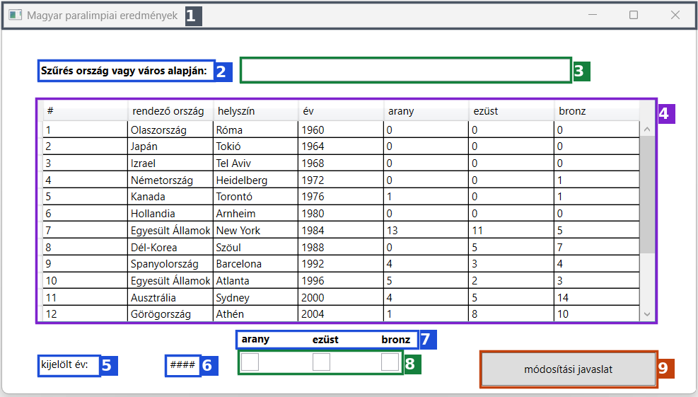
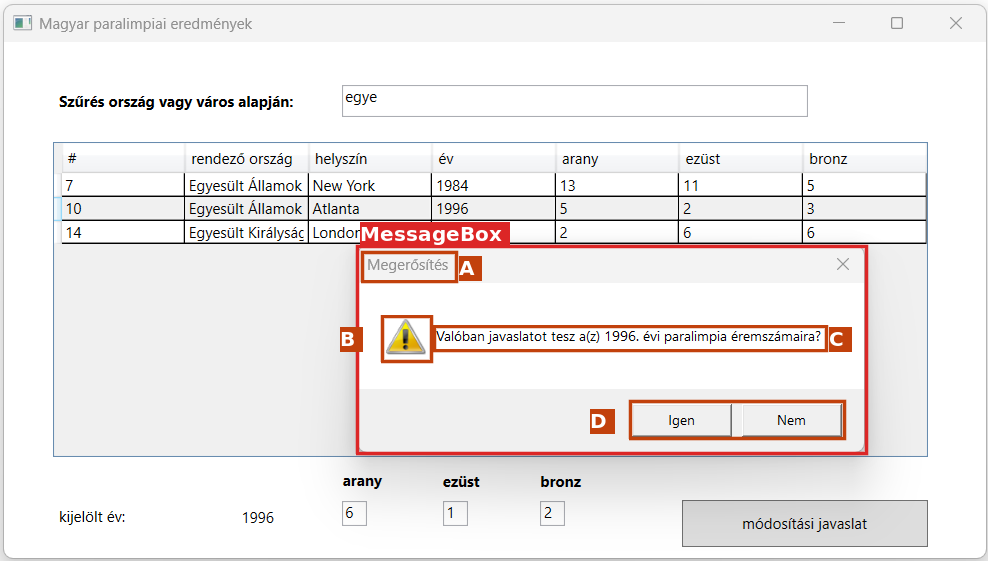
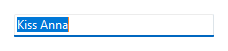
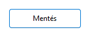
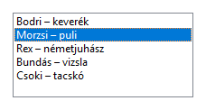
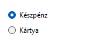
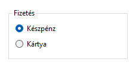
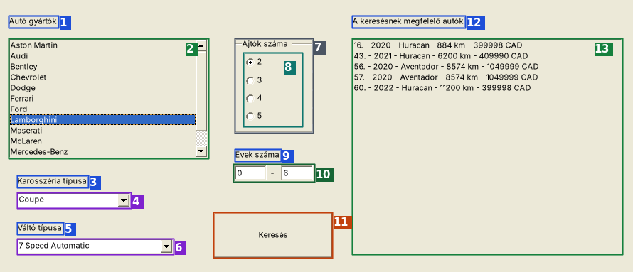

# GUI a nulláról – KEZDD ITT

Ha a GUI-ról semmit nem tudsz, ezt olvasd végig **sorban** (kb. 25 perc). Utána tudni fogod:
- hogyan nézd meg a mintaképet, és **honnan tudod, mit kell a Form1-re rakni**,
- mit jelentenek a feladatszöveg szavai,
- hogyan csinálsz a Visual Studióban egy működő ablakot.

---

## 1. Mit kapsz a vizsgán?

A feladatlapon a GUI-résznél ez van:
1. **Számozott feladatok** (pl. „11. Készítse el a grafikus alkalmazás statikus részeit a mintához hasonló elrendezésben!”).
2. **Mintakép**: egy képernyőkép a kész ablakról. **Ez alapján rakod fel a vezérlőket.**
3. Egy **adatfájl** a FORRÁS mappában (ugyanolyan, mint a CLI-nél).

A **vezérlő** (control) = minden, ami az ablakon van: felirat, szövegmező, gomb, lista, táblázat…

---

## 2. A mintakép szétszedése: honnan tudod, mit kell felrakni?

Ez egy **valódi vizsgalap mintaképe** (Paralimpia). Minden számozott keret **egy vezérlő**:



| # | Amit a képen látsz | Ez a vezérlő → a Toolboxban ezt keresd | (Name), amit adsz neki | Text (felirat) |
|---|---|---|---|---|
| 1 | az ablak címsora | **nem vezérlő**, hanem maga az ablak (Form1) | – | a Form1 **Text**-je: `Magyar paralimpiai eredmények` |
| 2 | szöveg, amit a felhasználó **nem tud átírni** | **Label** | mindegy | `Szűrés ország vagy város alapján:` |
| 3 | fehér, üres, keretes mező: **ide lehet gépelni** | **TextBox** | `txtSzuro` | – |
| 4 | **táblázat** oszlopfejlécekkel (#, rendező ország…) | **DataGridView** | `dgvErmek` | – |
| 5 | felirat | **Label** | mindegy | `kijelölt év:` |
| 6 | felirat, de a **kód írja bele** az évet (a `####` csak helyőrző) | **Label** | `lblEv` | `####` |
| 7 | 3 felirat | **Label** ×3 | mindegy | `arany`, `ezüst`, `bronz` |
| 8 | 3 kis mező: a kód írja beléjük az érmeket, a felhasználó **átírhatja** | **TextBox** ×3 | `txtArany`, `txtEzust`, `txtBronz` | – |
| 9 | szürke, keretes, kattintható | **Button** | `btnJavaslat` | `módosítási javaslat` |

> **Szabály:** amihez a **kód hozzányúl** (beleír, kiolvas, rákattintanak), annak adj beszédes **(Name)**-et. A sima feliratoknak nem kell.

### A felugró ablak NEM a Formon van!



Ez a **MessageBox**. Nem húzod fel a Toolboxból, hanem a **kód jeleníti meg** egy sorral:

```csharp
MessageBox.Show("Valóban javaslatot tesz a(z) 1996. évi paralimpia éremszámaira?",   // C: a szöveg
                "Megerősítés",                                                       // A: a cím
                MessageBoxButtons.YesNo,                                             // D: Igen + Nem gomb
                MessageBoxIcon.Warning);                                             // B: a sárga felkiáltójel
```

---

## 3. Vezérlő-felismerő: 4 kérdés

Nézz rá egy elemre a mintaképen, és kérdezd meg:

| Kérdés | Ha igen → |
|---|---|
| Lehet bele **gépelni**? | egysoros: **TextBox**; nagy, többsoros: **RichTextBox** |
| Csak **szöveg**, nem lehet beleírni? | **Label** |
| **Kattintható** gomb felirattal? | **Button** |
| **Sorok** egymás alatt, egyet ki lehet jelölni? | oszlopfejléc nélkül: **ListBox**; oszlopfejlécekkel (táblázat): **DataGridView** |
| Kis **nyíl ▼** a jobb szélén, lenyílik? | **ComboBox** |
| **Négyzet** (pipálható)? | **CheckBox** |
| **Kör**, és egy csoportban csak egy jelölhető? | **RadioButton** (a körülötte lévő feliratos keret: **GroupBox**) |
| **Szám** fel/le nyilakkal? | **NumericUpDown** |
| **Felugró** kis ablak OK / Igen / Nem gombokkal? | **MessageBox** (kódból, nem a Formra!) |

### Így néznek ki Windows-on (valódi képek)

| Kép | Név (Toolbox) | Mire jó | A feladatlapon így hívják |
|---|---|---|---|
|  | **Label** | szöveg kiírása | felirat, címke |
|  | **TextBox** | ide gépel a felhasználó | szövegmező, (szöveges) beviteli mező |
|  | **Button** | kattintásra fut a kód | gomb, parancsgomb |
|  | **ListBox** | lista, egy sor kijelölhető | lista, listamező |
|  | **ComboBox** | legördülő lista | legördülő / lenyíló lista |
|  | **DataGridView** | táblázat | adatrács, táblázat |
|  | **CheckBox** | igen/nem pipa | jelölőnégyzet |
|  | **RadioButton** | egy a többből | választógomb, rádiógomb |
|  | **GroupBox** | feliratos keret, a RadioButtonok csoportja | csoport, keret |
|  | **NumericUpDown** | szám nyilakkal | számléptető |
|  | **RichTextBox** | többsoros szöveg | többsoros szövegdoboz |
|  | **MessageBox** | felugró kérdés / üzenet (kódból) | üzenetablak, megerősítő ablak |

---

## 4. A feladatszöveg szótára

### Szavak → melyik vezérlő

| A feladatban ez áll… | Vezérlő |
|---|---|
| „felirat”, „címke”, „…jelenjen meg a … címkében” | **Label** |
| „szövegmező”, „beviteli mező”, „szöveges beviteli mező” | **TextBox** |
| „többsoros szövegdoboz” | **RichTextBox** |
| „lista”, „listamező”, „a bal oldali listában” | **ListBox** |
| „legördülő lista”, „lenyíló lista” | **ComboBox** |
| „adatrács”, „táblázat” | **DataGridView** |
| „gomb”, „parancsgomb” | **Button** |
| „jelölőnégyzet” | **CheckBox** |
| „választógomb”, „rádiógomb” | **RadioButton** (+ GroupBox) |
| „üzenetablak”, „megerősítő ablak”, „párbeszédablak” | **MessageBox** (kódból) |

### Szavak → melyik esemény / mit írsz a kódba

| A feladatban ez áll… | Esemény / kód |
|---|---|
| „**Az alkalmazás betöltésekor / indításakor** …” | `Load` esemény |
| „A … **gombra kattintva** …” | `Click` esemény |
| „Ha **kiválasztunk** egy elemet a listából / legördülő listából …” | `SelectedIndexChanged` esemény |
| „Ha **kijelöljük** az adatrácsban valamelyik sort …” | `CellClick` esemény |
| „Ha a beviteli mezőbe **gépelünk** …” | `TextChanged` esemény |
| „Ha **bejelöljük** a jelölőnégyzetet …” | `CheckedChanged` esemény |
| „… jelenjen meg a listában” | `lista.Items.Add(...)` |
| „… jelenjen meg a címkében / mezőben” | `cimke.Text = ...` |
| „… az első legyen kiválasztva” | `lista.SelectedIndex = 0;` |
| „… ne legyen kiválasztva semmi” | `SelectedIndex = -1;` / `Checked = false;` |
| „… mezők legyenek üresek” | `mezo.Text = "";` |
| „… írja ki a … fájlba … a további … is ugyanebbe” | `new StreamWriter(fajl, true)` |
| „a sor elejére a rendszeridőt” | `DateTime.Now` |
| „… majd az alkalmazás záródjon be” | `Application.Exit();` |

### Egy valódi feladatsor „lefordítva” (Paralimpia, 9–15.)

| A feladat szövege | Mit csinálsz |
|---|---|
| 9. Készítsen grafikus alkalmazást … **ParalimpiaGUI** néven! | Visual Studio → új projekt → **Windows Forms App** → név: `ParalimpiaGUI` |
| 10. Készítsen saját osztályt **Paralimpia** azonosítóval! … konstruktor … Olvassa be az adatforrás adatait … | Add → Class → `Paralimpia.cs` (ugyanúgy, mint a CLI-ben). A beolvasás a `Load`-ba kerül. |
| 11. Készítse el a grafikus alkalmazás **statikus részeit** a mintához hasonló elrendezésben! | **A mintakép alapján felrakod a vezérlőket** (2. fejezet). „Statikus” = ami a képen kód nélkül is látszik. |
| 12. **Az alkalmazás betöltésekor** jelenjen meg … összes rekordja az alkalmazásablak **adatrácsában**! | `Load` → a DataGridView-ba oszlopok + minden sor (`Rows.Add`) |
| 13. Ha a … **szöveges beviteli mezőbe gépelünk**, az adatrács csak azokat … tartalmazza, ahol az orszag vagy varos … a mező tartalmával **kezdődik**! | a TextBox `TextChanged` eseménye → szűrés `StartsWith`-szel → adatrács újratöltése |
| 14. Ha **egérkattintással kijelöljük az adatrácsban** valamelyik sort, … az Ev … jelenjen meg … a megfelelő **címkében**, … az Arany, Ezust és Bronz … a megfelelő **beviteli mezőkben**! | a DataGridView `CellClick` eseménye → `lblEv.Text = ...`, `txtArany.Text = ...` |
| 15. … a **parancsgombra kattintva** … minta szerinti **üzenetablak** elfogadása után … írja ki a **javaslat.txt** fájlba … a sor elejére a **rendszeridőt** … a további javaslatok **ugyanebbe** a fájlba | a Button `Click` eseménye → `MessageBox` Igen/Nem → ha Igen: `StreamWriter(..., true)` + `DateTime.Now` |

> Ugyanez a feladattípus megoldva: [2_GYAKORLO_FELADATOK/02_ErmekGUI](2_GYAKORLO_FELADATOK/02_ErmekGUI/LEPESROL_LEPESRE.md).

---

## 5. A Visual Studio a nulláról

### A képernyő

```
┌──────────────────────────────────────────────────────────────────────────────┐
│ File  Edit  View  ...          ▶ AutoGUI  (zöld nyíl = futtatás, vagy F5)     │
├────────┬────────────────────────────────────────────┬────────────────────────┤
│TOOLBOX │  Form1.cs [Design]                          │ SOLUTION EXPLORER      │
│(bal    │  ┌───────────────────────────────┐          │  AutoGUI               │
│ szélen │  │ Form1                    _ □ x │          │   ├ Form1.cs   ← dupla │
│ fül,   │  │                               │          │   ├ Auto.cs      klikk │
│ ha nem │  │   ide húzod a vezérlőket      │          │   └ Program.cs         │
│ látszik:│ │                               │          ├────────────────────────┤
│ View → │  └───────────────────────────────┘          │ PROPERTIES (F4)        │
│Toolbox)│                                             │  (Name)  btnKereses    │
│        │                                             │  Text    Keresés       │
└────────┴────────────────────────────────────────────┴────────────────────────┘
```

| Ablak | Mire jó | Ha nem látod |
|---|---|---|
| **Designer** (`Form1.cs [Design]`) | itt rajzolod az ablakot | Solution Explorerben dupla klikk a `Form1.cs`-en |
| **Toolbox** | innen húzod a vezérlőket | **View → Toolbox** (Ctrl+Alt+X); a tetején kereső |
| **Properties** | a kijelölt vezérlő beállításai: **(Name)**, **Text** | jobb klikk a vezérlőn → **Properties** (F4) |
| **kód** (`Form1.cs`) | ide írod, mi történjen | a Designerben jobb klikk → **View Code** (F7) |

### Az első ablakod 10 perc alatt (gyakorold ezt egyszer!)

**Cél:** beírod a neved, megnyomod a gombot, és az ablak köszön.

1. **File → New → Project** → keresőbe: `Windows Forms` → **Windows Forms App** (C#, NEM a „.NET Framework”-ös) → Next → név: `ElsoAblak` → Next → **Create**.
2. **Toolbox** → **TextBox** → húzd az ablakra. **Properties** → **(Name)**: `txtNev`
3. **Toolbox** → **Button** → húzd mellé. **(Name)**: `btnKoszon`, **Text**: `Köszönj!`
4. **Toolbox** → **Label** → húzd alá. **(Name)**: `lblUzenet`, **Text**: töröld ki (üres).
5. **F7** (kód). Írd át így:

```csharp
namespace ElsoAblak
{
    public partial class Form1 : Form
    {
        public Form1()
        {
            InitializeComponent();                       // felrakja a megrajzolt vezérlőket
            btnKoszon.Click += BtnKoszon_Click;          // HA a gombra kattintanak, EZ fusson le:
        }

        private void BtnKoszon_Click(object sender, EventArgs e)
        {
            if (txtNev.Text == "")                       // nem írt be semmit?
            {
                MessageBox.Show("Írd be a neved!", "Hiba", MessageBoxButtons.OK, MessageBoxIcon.Warning);
                return;
            }
            lblUzenet.Text = "Szia, " + txtNev.Text + "!";   // a címkébe írunk
        }
    }
}
```

6. **F5** → írd be: `Marci` → **Köszönj!** → megjelenik: **Szia, Marci!** Üresen → felugrik a MessageBox.

**Ami most történt, az minden vizsgafeladat lényege:**

```
 1. RAJZOLÁS (Designer)  →  2. NÉV (Properties: (Name))  →  3. ESEMÉNY (+= a konstruktorban)
                                                                      │
 6. PRÓBA (F5)  ←  5. KÓD (a metódusban: Text, Items.Add, MessageBox...)  ←  4. METÓDUS
```

> Tipp a 3–4. lépéshez: írd be a `+=` sort, és ha a metódus neve piros, kattints rá → **Ctrl + .** → **Generate method**.

> **Piros vagy zöld aláhúzás?** **Piros** hullámos vonal = **hiba**, a program nem indul el, javítani kell. **Zöld** hullámos vonal = csak **figyelmeztetés** (pl. a `sender` alatt), a program **nyugodtan futtatható**, nem kell vele foglalkozni.

---

## 6. A te vizsgád ablaka (AutoGUI) szétszedve



| # | Vezérlő | (Name) | Text / megjegyzés |
|---|---|---|---|
| 1, 3, 5, 9, 12 | **Label** | mindegy | `Autó gyártók`, `Karosszéria típusa`, `Váltó típusa`, `Évek száma`, `A keresésnek megfelelő autók` |
| 2 | **ListBox** | `lbGyartok` | a gyártók |
| 4 | **ComboBox** | `cbKarosszeria` | DropDownStyle: DropDownList |
| 6 | **ComboBox** | `cbValto` | DropDownStyle: DropDownList |
| 7 | **GroupBox** | `grpAjtok` | `Ajtók száma` |
| 8 | **RadioButton** ×4 (a GroupBox **belsejébe** húzva!) | `rb2`, `rb3`, `rb4`, `rb5` | `2`, `3`, `4`, `5` |
| 10 | **TextBox** ×2 (köztük egy `-` Label) | `txtKorTol`, `txtKorIg` | – |
| 11 | **Button** | `btnKereses` | `Keresés` |
| 13 | **ListBox** | `lbTalalatok` | a találatok |

➡️ **Végig lépésenként:** [01_AutokGUI/LEPESROL_LEPESRE.md](2_GYAKORLO_FELADATOK/01_AutokGUI/LEPESROL_LEPESRE.md)

---

## 7. Hogyan tovább?

1. [0_ALAPOK_KEZDOKNEK.md](0_ALAPOK_KEZDOKNEK.md): az események részletesebben (10 perc)
2. [01_AutokGUI lépésről lépésre](2_GYAKORLO_FELADATOK/01_AutokGUI/LEPESROL_LEPESRE.md): a te vizsgád, végig
3. [README.md](README.md): a 6 lépés és a keresőtábla, ezt használd a vizsgán
