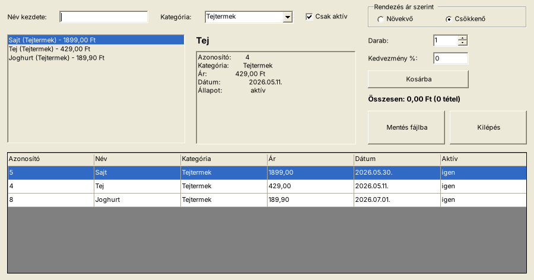

# 0_GYORSINDITO (GUI)

Egy kész, futtatható Windows Forms ablak, amiben **minden gyakori vizsgafeladat** benne van, egy-egy jelölt blokkban.
A [Form1.cs](Form1.cs)-ben minden blokk fölött ez áll: **„HA A FELADAT EZT KÉRI:”**.



| Blokk | Mire jó | Esemény | Technika |
|---|---|---|---|
| **[A]** | betöltés: beolvasás, oszlopok, kezdőállapot | `Load` | [04](../1_TECHNIKAK/04_Betoltes_Load.md) |
| **[B]** | ListBox feltöltése objektumokkal, az első kiválasztva | – | [05](../1_TECHNIKAK/05_ListBox.md) |
| **[C]** | ComboBox: „(mindegyik)” + kategóriák ismétlés nélkül | `SelectedIndexChanged` | [06](../1_TECHNIKAK/06_ComboBox.md) |
| **[D]** | kiválasztott elem részletei Labelbe és RichTextBoxba | `SelectedIndexChanged` | [08](../1_TECHNIKAK/08_Reszletek_Labelbe.md) |
| **[E]** | DataGridView: oszlopok, sorok, kijelölt sor | `CellClick` | [07](../1_TECHNIKAK/07_DataGridView.md) |
| **[F]** | szűrés gépelésre (`StartsWith`) | `TextChanged` | [09](../1_TECHNIKAK/09_Szures_gepelesre.md) |
| **[G]** | CheckBox-szűrés, RadioButton-rendezés | `CheckedChanged` | [10](../1_TECHNIKAK/10_CheckBox_RadioButton.md) |
| **[H]** | gomb + ellenőrzés: kiválasztás, `TryParse`, NumericUpDown | `Click` | [11](../1_TECHNIKAK/11_Szam_bevitel_ellenorzes.md) |
| **[I]** | megerősítés (Igen/Nem) + fájlba hozzáfűzés dátummal | `Click` | [12](../1_TECHNIKAK/12_MessageBox.md), [13](../1_TECHNIKAK/13_Fajlba_iras_hozzafuzes.md) |
| **[J]** | összeg számolása, címke frissítése (kosár) | `Click` | [14](../1_TECHNIKAK/14_Szamolas_kosar_osszeg.md) |
| **[K]** | kilépés megerősítéssel | `Click` | [12](../1_TECHNIKAK/12_MessageBox.md) |

## Egy ötlet: a szűrők egy metódusban

A gépelés, a ComboBox, a CheckBox és a RadioButton **ugyanazt** a `Szures()` metódust hívja, ami **minden** feltételt egyszerre néz. Így nem kell négyféle szűrést írni, és a feltételek együtt is működnek.

```csharp
txtSzuro.TextChanged += Szures_Esemeny;
cbKategoria.SelectedIndexChanged += Szures_Esemeny;
chkCsakAktiv.CheckedChanged += Szures_Esemeny;
rbNovekvo.CheckedChanged += Szures_Esemeny;
```

## Használat a vizsgán

1. Hozd létre a saját projektedet (Windows Forms App, a kért néven).
2. Rajzold meg az ablakot a vizsga mintaképe szerint. A vezérlőket nevezd el úgy, mint itt (`lbElemek`, `cbKategoria`…), vagy a kimásolt kódban írd át a neveket.
3. A [Form1.cs](Form1.cs)-ből másold ki a kellő blokkokat, és írd át a mezőneveket és a szövegeket a feladat szerint.
