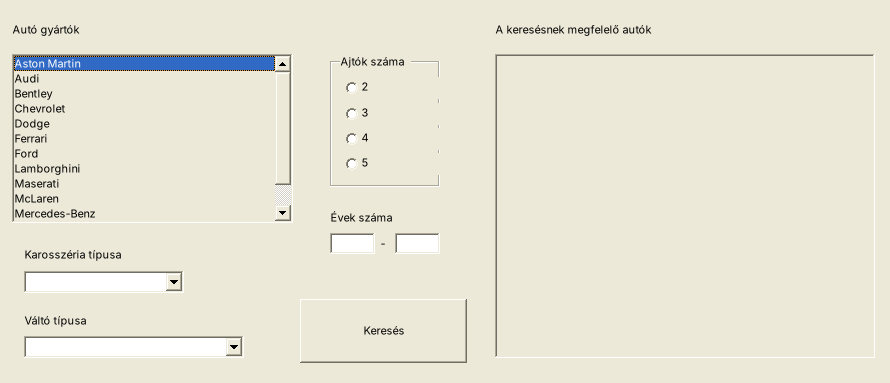
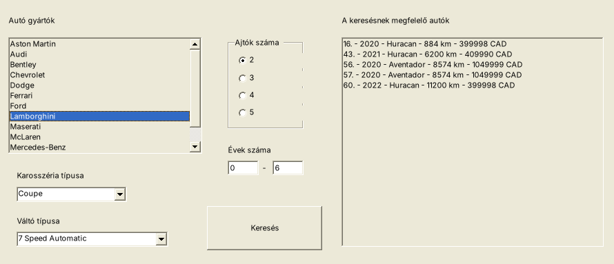

# 01 – AutoGUI (a te vizsgád GUI-része)

> A feladatszöveget a te `AutoGUI` repód megoldásából raktam össze (11–17. lépés).
> Vizsgán mindig a **kiadott szöveget és mintaképet** kövesd!
> Az adatfájl a vizsga eredeti `carsData.csv`-je (198 autó, vesszős tizedesjegyek).

## Feladatok

9. Készítsen grafikus alkalmazást (**Windows Forms App**) **AutoGUI** néven!
10. Használja fel a konzolos részben elkészített `Auto`, `Gyarto`, `Karosszeria` és `Valto` osztályokat, és olvassa be a `carsData.csv` adatait!
11. Az alkalmazás betöltésekor a bal oldali listában jelenjenek meg a gyártók, **mindegyik csak egyszer**. Az első gyártó legyen kiválasztva!
12. A „Karosszéria típusa” legördülő listában jelenjenek meg a karosszériák (ismétlés nélkül). Induláskor **ne legyen kiválasztva** semmi!
13. A „Váltó típusa” legördülő listában ugyanígy a váltók. Induláskor ne legyen kiválasztva semmi!
14. Az „Ajtók száma” csoportban 4 rádiógomb legyen (2, 3, 4, 5). Induláskor **egyik se** legyen bejelölve!
15. Az „Évek száma” két szövegmezője induláskor legyen üres!
16. A **Keresés** gombra kattintva a jobb oldali listában jelenjenek meg azok az autók, amelyeknek a gyártója, karosszériája, váltója és ajtóinak száma megegyezik a kiválasztottal, és a koruk (aktuális év − évjárat) a két megadott érték közé esik (a határokat is beleértve)! Egy sor formája:
    `16. - 2020 - Huracan - 884 km - 399998 CAD`
17. Új keresés előtt az előző találatok törlődjenek a listából!

**Extra (a megoldásban benne van, a vizsgán nem biztos, hogy kérik):** ha valami nincs kiválasztva vagy nem számot írtak be, hibaüzenet; ha nincs találat, tájékoztató üzenet.

## Az ablak (mintakép)

```
┌─ Használt autók ──────────────────────────────────────────────────────────────────────┐
│ Autó gyártók                                        A keresésnek megfelelő autók       │
│ ┌───────────────────────────┐   ┌─Ajtók száma─┐     ┌──────────────────────────────┐  │
│ │Aston Martin               │   │  ( ) 2      │     │16. - 2020 - Huracan - 884 km │  │
│ │Audi                       │   │  ( ) 3      │     │43. - 2021 - Huracan - 6200 km│  │
│ │Bentley                    │   │  ( ) 4      │     │...                           │  │
│ │...                        │   │  ( ) 5      │     │                              │  │
│ └───────────────────────────┘   └─────────────┘     │                              │  │
│                                  Évek száma         │                              │  │
│  Karosszéria típusa              [  0 ] - [  6 ]    │                              │  │
│  [Coupe              ▼]                             │                              │  │
│  Váltó típusa                   ┌──────────────┐    │                              │  │
│  [7 Speed Automatic    ▼]       │   Keresés    │    │                              │  │
│                                 └──────────────┘    └──────────────────────────────┘  │
└───────────────────────────────────────────────────────────────────────────────────────┘
```

A megoldás futás közben (Linuxon renderelve, Windows-on kicsit másképp néz ki):

| Betöltés után | Keresés után |
|---|---|
|  |  |

## Ellenőrző adat

Lamborghini, Coupe, 7 Speed Automatic, 2 ajtó, 0–6 év (2026-ban) → **5 találat**:

```
16. - 2020 - Huracan - 884 km - 399998 CAD
43. - 2021 - Huracan - 6200 km - 409990 CAD
56. - 2020 - Aventador - 8574 km - 1049999 CAD
57. - 2020 - Aventador - 8574 km - 1049999 CAD
60. - 2022 - Huracan - 11200 km - 399998 CAD
```

## Amit gyakorol

| Feladat | Technika |
|---|---|
| 9–10. | [01 Projekt és osztály](../../1_TECHNIKAK/01_Projekt_es_osztaly.md) |
| ablak | [02 Designer](../../1_TECHNIKAK/02_Designer_hasznalata.md) |
| konstruktor | [03 Események bekötése](../../1_TECHNIKAK/03_Esemenyek_bekotese.md) |
| 11–15. | [04 Load](../../1_TECHNIKAK/04_Betoltes_Load.md), [05 ListBox](../../1_TECHNIKAK/05_ListBox.md), [06 ComboBox](../../1_TECHNIKAK/06_ComboBox.md), [10 RadioButton](../../1_TECHNIKAK/10_CheckBox_RadioButton.md) |
| 16–17. | [11 Szám ellenőrzése](../../1_TECHNIKAK/11_Szam_bevitel_ellenorzes.md), [12 MessageBox](../../1_TECHNIKAK/12_MessageBox.md) |

**Lépésről lépésre:** [LEPESROL_LEPESRE.md](LEPESROL_LEPESRE.md) · **Megoldás:** [Megoldas/](Megoldas/)
