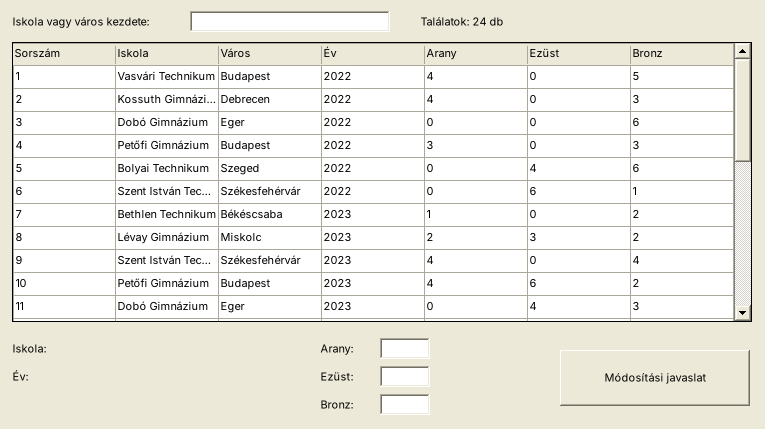
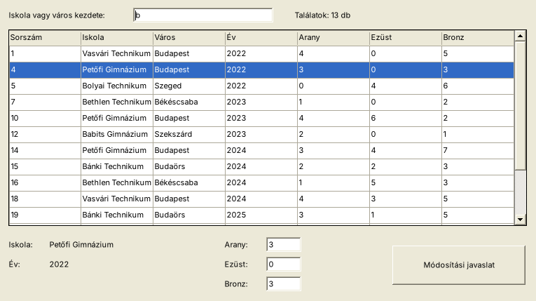

# 02 – ErmekGUI (Paralimpia- / Éremtábla-típus)

> Mintája: a ParalimpiaGUI hivatalos feladatlapja. Az adatok kitaláltak (diákolimpia).

**Adatfájl:** `Megoldas/forras/ermek.txt`: UTF-8, **tabulátorral** elválasztva, az első sor a fejléc.

| Mező | Típus |
|---|---|
| Id | egész (sorszám) |
| Iskola | szöveg |
| Varos | szöveg |
| Ev | egész |
| Arany, Ezust, Bronz | egész (érmek száma) |

## Feladatok

9. Készítsen grafikus alkalmazást **ErmekGUI** néven!
10. Készítsen `Eredmeny` osztályt a fenti adattagokkal és konstruktorral! Olvassa be az adatokat egy összetett adatszerkezetbe!
11. Készítse el az alkalmazás statikus részeit a mintához hasonló elrendezésben!
12. Az alkalmazás betöltésekor jelenjen meg az **összes** rekord az **adatrácsban**!
13. Ha a fenti szöveges beviteli mezőbe gépelünk, az adatrács csak azokat a rekordokat tartalmazza, ahol az iskola **vagy** a város a mező tartalmával **kezdődik** (a kis- és nagybetű ne számítson)! A találatok száma jelenjen meg a mező mellett!
14. Ha egérkattintással kijelölünk egy sort, az iskola és az év jelenjen meg a lenti címkékben, az arany, ezüst és bronz érmek száma pedig a beviteli mezőkben! (Ezeket a felhasználó módosíthatja.)
15. A **Módosítási javaslat** gombra kattintva jelenjen meg egy megerősítő üzenetablak (Igen/Nem). Igen esetén írja ki a javaslatot a `javaslat.txt` fájlba: a sor elejére a **rendszeridőt**, utána tabulátorral elválasztva az iskolát, az évet és az érmeket! A további javaslatok **ugyanebbe** a fájlba kerüljenek (hozzáfűzés)!

**Extra:** ha nincs kijelölt sor, a gomb hibaüzenetet ad.

## Az ablak (mintakép)

```
┌─ Diákolimpia – éremtábla ──────────────────────────────────────────────────────┐
│ Iskola vagy város kezdete: [b_______________]   Találatok: 13 db               │
│ ┌──────────┬───────────────────┬────────────┬──────┬───────┬───────┬───────┐   │
│ │ Sorszám  │ Iskola            │ Város      │ Év   │ Arany │ Ezüst │ Bronz │   │
│ ├──────────┼───────────────────┼────────────┼──────┼───────┼───────┼───────┤   │
│ │ 1        │ Vasvári Technikum │ Budapest   │ 2022 │ 4     │ 0     │ 5     │   │
│ │▓4▓▓▓▓▓▓▓▓│▓Petőfi Gimnázium▓▓│▓Budapest▓▓▓│▓2022▓│▓3▓▓▓▓▓│▓0▓▓▓▓▓│▓3▓▓▓▓▓│   │
│ │ ...      │                   │            │      │       │       │       │   │
│ └──────────┴───────────────────┴────────────┴──────┴───────┴───────┴───────┘   │
│ Iskola:  Petőfi Gimnázium          Arany: [3 ]       ┌──────────────────────┐  │
│ Év:      2022                      Ezüst: [0 ]       │ Módosítási javaslat  │  │
│                                    Bronz: [3 ]       └──────────────────────┘  │
└────────────────────────────────────────────────────────────────────────────────┘
```

A megoldás futás közben:

| Betöltés után | Szűrés („b”) és kijelölés után |
|---|---|
|  |  |

## Ellenőrző adatok

- Betöltés: **24 sor**.
- Szűrés `b`-re: **13 sor** (Budapest, Békéscsaba, Budaörs városok, és a B betűs iskolák: Bolyai, Bethlen, Babits, Bánki).
- A `javaslat.txt` egy sora: `2026. 10. 12. 9:15:30	Petőfi Gimnázium	2022	Érmek: 9	0	3`

## Amit gyakorol

| Feladat | Technika |
|---|---|
| 10. | [01 Projekt és osztály](../../1_TECHNIKAK/01_Projekt_es_osztaly.md) (tabulátor!) |
| 12. | [07 DataGridView](../../1_TECHNIKAK/07_DataGridView.md) |
| 13. | [09 Szűrés gépelésre](../../1_TECHNIKAK/09_Szures_gepelesre.md) |
| 14. | [07 CellClick](../../1_TECHNIKAK/07_DataGridView.md), [08 Részletek](../../1_TECHNIKAK/08_Reszletek_Labelbe.md) |
| 15. | [12 MessageBox](../../1_TECHNIKAK/12_MessageBox.md), [13 Fájlba írás](../../1_TECHNIKAK/13_Fajlba_iras_hozzafuzes.md) |

**Lépésről lépésre:** [LEPESROL_LEPESRE.md](LEPESROL_LEPESRE.md) · **Megoldás:** [Megoldas/](Megoldas/)
