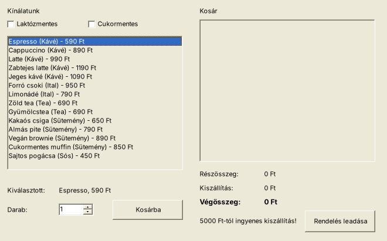
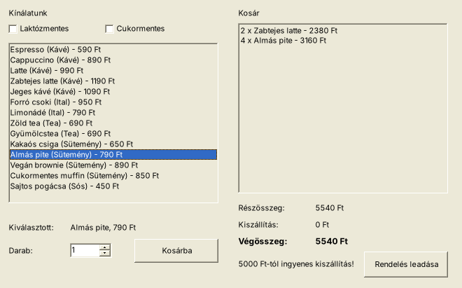

# 03 – RendelesGUI (Pizza-típus: szűrés jelölőnégyzetekkel, kosár, végösszeg)

> Mintája: a PizzaGUI. Az adatok kitaláltak (kávézó).

**Adatfájl:** `Megoldas/forras/kinalat.txt`: UTF-8, `;`, az első sor a fejléc.

| Mező | Típus |
|---|---|
| Nev | szöveg |
| Kategoria | szöveg |
| Ar | egész (Ft) |
| Laktozmentes | `1` / `0` |
| Cukormentes | `1` / `0` |

## Feladatok

9. Készítsen grafikus alkalmazást **RendelesGUI** néven!
10. Készítsen `Termek` osztályt! A `ToString()` adja vissza: `Latte (Kávé) - 990 Ft`. Olvassa be az adatokat!
11. Készítse el a statikus részeket a minta szerint!
12. Betöltéskor a bal oldali listában jelenjen meg a teljes kínálat, az első termék legyen kiválasztva, az összegek `0 Ft` legyenek!
13. Ha kiválasztunk egy terméket, a neve és ára jelenjen meg a „Kiválasztott” címkében!
14. Ha bejelöljük a **Laktózmentes** jelölőnégyzetet, csak a laktózmentes termékek látszanak; ha a **Cukormentes**-t, csak a cukormentesek; ha mindkettőt, csak azok, amelyek mindkettők!
15. A **Kosárba** gombra a kiválasztott termék a megadott darabszámmal (1–10, NumericUpDown) kerüljön a kosárba (`2 x Latte - 1980 Ft`)! Frissüljön a részösszeg, a kiszállítási díj (**690 Ft, de 5000 Ft-tól ingyenes**) és a végösszeg!
16. A **Rendelés leadása** gombra jelenjen meg egy megerősítő üzenetablak a végösszeggel (Igen/Nem)! Igen esetén a rendelés kerüljön a `rendelesek.txt` fájl végére (`dátum;tételek;végösszeg`), majd ürüljön ki a kosár! Üres kosárnál hibaüzenet jelenjen meg!

## Az ablak (mintakép)

```
┌─ Kávézó – rendelés ─────────────────────────────────────────────────┐
│ Kínálatunk                             Kosár                         │
│ [ ] Laktózmentes   [ ] Cukormentes     ┌──────────────────────────┐  │
│ ┌──────────────────────────────┐       │2 x Zabtejes latte - 2380 │  │
│ │Espresso (Kávé) - 590 Ft      │       │4 x Almás pite - 3160 Ft  │  │
│ │Cappuccino (Kávé) - 890 Ft    │       │                          │  │
│ │...                           │       └──────────────────────────┘  │
│ └──────────────────────────────┘       Részösszeg:  5540 Ft         │
│ Kiválasztott:  Almás pite, 790 Ft      Kiszállítás: 0 Ft            │
│ Darab: [ 1 ▲▼]   [  Kosárba  ]         Végösszeg:   5540 Ft         │
│                                        5000 Ft-tól ingyenes!  [Rendelés leadása] │
└──────────────────────────────────────────────────────────────────────┘
```

| Betöltés után | Kosár két tétellel |
|---|---|
|  |  |

## Ellenőrző adatok

- Betöltéskor 14 termék; laktózmentes: 6; laktóz- és cukormentes: 4.
- 2 × Zabtejes latte → részösszeg 2380, kiszállítás 690, végösszeg **3070 Ft**.
- + 4 × Almás pite → részösszeg 5540, kiszállítás **0**, végösszeg **5540 Ft**.

## Amit gyakorol

| Feladat | Technika |
|---|---|
| 12–13. | [05 ListBox](../../1_TECHNIKAK/05_ListBox.md) (objektum a listában!), [08 Részletek](../../1_TECHNIKAK/08_Reszletek_Labelbe.md) |
| 14. | [10 CheckBox](../../1_TECHNIKAK/10_CheckBox_RadioButton.md) |
| 15. | [11 NumericUpDown](../../1_TECHNIKAK/11_Szam_bevitel_ellenorzes.md), [14 Kosár, összeg](../../1_TECHNIKAK/14_Szamolas_kosar_osszeg.md) |
| 16. | [12 MessageBox](../../1_TECHNIKAK/12_MessageBox.md), [13 Fájlba írás](../../1_TECHNIKAK/13_Fajlba_iras_hozzafuzes.md) |

**Lépésről lépésre:** [LEPESROL_LEPESRE.md](LEPESROL_LEPESRE.md) · **Megoldás:** [Megoldas/](Megoldas/)
