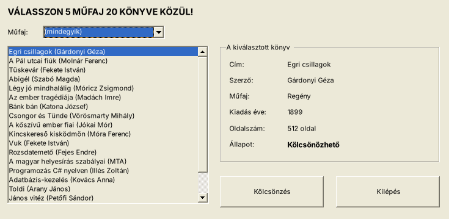
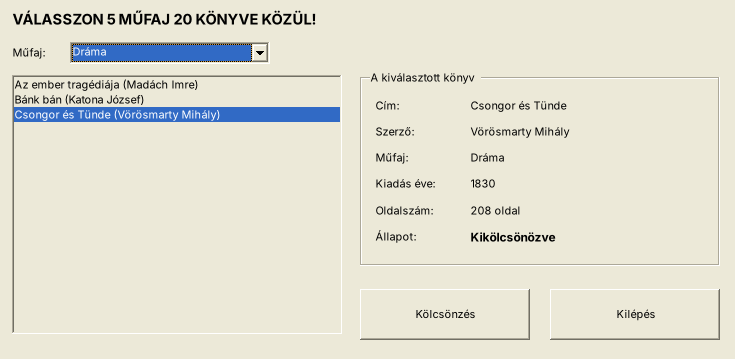

# 04 – KonyvtarGUI (Menhely- / Laptops- / Várak-típus: ComboBox-szűrés, részletek, Igen/Nem)

> Mintája: a MenhelyGUI és a LaptopsGUI. Az adatok kitaláltak (iskolai könyvtár).
> A mappa neve `04_ReszletekGUI`, a projekté `KonyvtarGUI`.

**Adatfájl:** `Megoldas/forras/konyvek.txt`: UTF-8, `;`, az első sor a fejléc.

| Mező | Típus |
|---|---|
| Id | egész |
| Cim, Szerzo, Mufaj | szöveg |
| Kiadas | egész (év) |
| Oldalszam | egész |
| Kikolcsonozve | `1` / `0` |

## Feladatok

9. Készítsen grafikus alkalmazást **KonyvtarGUI** néven!
10. Készítsen `Konyv` osztályt (a `ToString()` adja: `Cím (Szerző)`)! Olvassa be az adatokat!
11. Készítse el a statikus részeket a minta szerint!
12. Betöltéskor a felső címkében jelenjen meg: `VÁLASSZON 5 MŰFAJ 20 KÖNYVE KÖZÜL!` (a számokat a program számolja ki)! A legördülő listában jelenjen meg az `(mindegyik)` lehetőség és utána a műfajok ABC sorrendben, ismétlés nélkül! Az `(mindegyik)` legyen kiválasztva!
13. Műfaj kiválasztásakor a listában csak az adott műfajú könyvek látszanak (`(mindegyik)` esetén az összes), és az első legyen kiválasztva!
14. Könyv kiválasztásakor a jobb oldali keretben jelenjenek meg az adatai: cím, szerző, műfaj, kiadás éve, oldalszám (`208 oldal`), állapot (`Kölcsönözhető` / `Kikölcsönözve`)!
15. A **Kölcsönzés** gombra: ha a könyv már ki van kölcsönözve, jelenjen meg erről üzenet! Különben megerősítő üzenetablak (Igen/Nem). Igen esetén a `kolcsonzesek.txt` végére kerüljön egy sor (`dátum;azonosító;cím`), és a könyv állapota változzon „Kikölcsönözve”-re!
16. A **Kilépés** gombra jelenjen meg: `Ön 4 könyvet tekintett meg. Biztosan kilép?` (a megnézett **különböző** könyvek száma). Igen esetén a program záródjon be!

## Az ablak (mintakép)

```
┌─ Iskolai könyvtár ────────────────────────────────────────────────────────┐
│ VÁLASSZON 5 MŰFAJ 20 KÖNYVE KÖZÜL!                                         │
│ Műfaj: [Dráma            ▼]                                                │
│ ┌────────────────────────────────────┐  ┌─A kiválasztott könyv────────────┐│
│ │Az ember tragédiája (Madách Imre)   │  │ Cím:         Csongor és Tünde   ││
│ │Bánk bán (Katona József)            │  │ Szerző:      Vörösmarty Mihály  ││
│ │▓Csongor és Tünde (Vörösmarty M.)▓▓▓│  │ Műfaj:       Dráma              ││
│ │                                    │  │ Kiadás éve:  1830               ││
│ │                                    │  │ Oldalszám:   208 oldal          ││
│ │                                    │  │ Állapot:     Kikölcsönözve      ││
│ │                                    │  └─────────────────────────────────┘│
│ │                                    │  [   Kölcsönzés   ] [   Kilépés    ] │
│ └────────────────────────────────────┘                                     │
└────────────────────────────────────────────────────────────────────────────┘
```

| Betöltés után | Dráma szűrés, kölcsönzés után |
|---|---|
|  |  |

## Ellenőrző adatok

- Felirat: `VÁLASSZON 5 MŰFAJ 20 KÖNYVE KÖZÜL!`
- Dráma: 3 könyv; a **Bánk bán** már ki van kölcsönözve → üzenet.
- Csongor és Tünde → Igen → `kolcsonzesek.txt`: `2026. 10. 12. 9:20:11;8;Csongor és Tünde`.
- Ha betöltés után a Dráma műfaj 3 könyvét nézed meg: Egri csillagok + 3 dráma = **4** megtekintett könyv.

## Amit gyakorol

| Feladat | Technika |
|---|---|
| 12. | [04 Load, felirat számmal](../../1_TECHNIKAK/04_Betoltes_Load.md), [06 ComboBox](../../1_TECHNIKAK/06_ComboBox.md) |
| 13. | [06 ComboBox kiválasztás](../../1_TECHNIKAK/06_ComboBox.md), [05 ListBox](../../1_TECHNIKAK/05_ListBox.md) |
| 14. | [08 Részletek](../../1_TECHNIKAK/08_Reszletek_Labelbe.md), [15 Buktatók #1](../../1_TECHNIKAK/15_Buktatok.md) (szűrt lista + index) |
| 15. | [12 MessageBox](../../1_TECHNIKAK/12_MessageBox.md), [13 Fájlba írás](../../1_TECHNIKAK/13_Fajlba_iras_hozzafuzes.md) |
| 16. | [12 Application.Exit](../../1_TECHNIKAK/12_MessageBox.md) |

**Lépésről lépésre:** [LEPESROL_LEPESRE.md](LEPESROL_LEPESRE.md) · **Megoldás:** [Megoldas/](Megoldas/)
