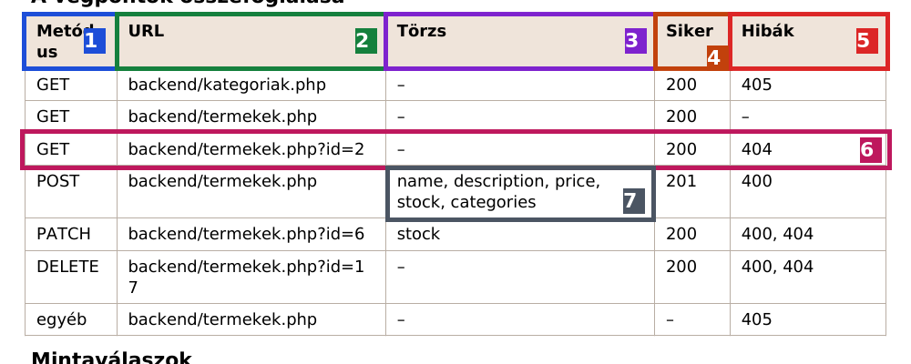

# PHP a nulláról – KEZDD ITT

Ha a PHP-ról semmit nem tudsz, ezt olvasd végig **sorban** (kb. 25 perc). Utána tudni fogod:
- mit kapsz a vizsgán, és **hogyan olvasd a feladatlapot** (végpont-táblázat, mintaválasz),
- **hány és milyen nevű PHP fájlt kell írnod**, és mi kerül beléjük,
- hogyan indítasz el egy működő PHP fájlt.

> Ha azt sem tudod, mi a PHP: előbb a [0_ALAPOK_KEZDOKNEK.md](0_ALAPOK_KEZDOKNEK.md) 1–3. pontja (5 perc).

---

## 1. Mit kapsz a vizsgán?

```
Források/3_PHP/
├── babszem_webshop.sql          ← az ADATBÁZIS: phpMyAdminban importálod
└── babszem_webshop/
    ├── frontend/                ← KÉSZ weboldal: nem kell hozzányúlni!
    └── backend/                 ← ÜRES: IDE írod a PHP fájlokat
```

A feladatlapon:
1. **Előkészítés**: XAMPP indítása, importálás, másolás a htdocs-ba (lépésről lépésre: [01 technika](1_TECHNIKAK/01_XAMPP_elokeszites.md)).
2. **Az adatbázis táblái**: a táblák és az oszlopok nevei. **Ezeket használod az SQL-ben.**
3. **Feladatok** pontszámmal.
4. **A végpontok összefoglalása**: táblázat. **Ez a legfontosabb!**
5. **Mintaválaszok**: pontosan milyen JSON-t kell visszaadni.

---

## 2. A végpont-táblázat olvasása: honnan tudod, mit kell írni?



| # | Oszlop | Mit jelent | A PHP-ban |
|---|---|---|---|
| **1** | **Metódus** | milyen kérés jön: GET = lekérdezés, POST = új, PATCH = módosítás, DELETE = törlés | `if ($_SERVER["REQUEST_METHOD"] === "GET") { ... }` |
| **2** | **URL** | **melyik fájl** (a `backend` mappában) és milyen **paraméter** (`?id=2`) | a fájl neve: `termekek.php`; a paraméter: `$_GET["id"]` |
| **3** | **Törzs** | POST/PATCH-nél ezek a mezők jönnek JSON-ban | `json_decode(file_get_contents("php://input"), true)` |
| **4** | **Siker** | a sikeres válasz kódja | 200 = alap; 201: `http_response_code(201)` |
| **5** | **Hibák** | milyen hibakódokat kell tudni | 400 = rossz adat, 404 = nincs ilyen, 405 = rossz metódus |
| **6** | egy **sor** | **egy eset**, amit a fájlnak kezelnie kell | egy `if` ág a fájlban |
| **7** | a POST törzse | ezek a kulcsok jönnek a JSON-ban | `$adat["name"]`, `$adat["price"]`… |

### A 6-os sor „lefordítva”

> `GET  backend/termekek.php?id=2  –  200  404`

= „A **termekek.php** fájlban, ha a kérés **GET**, és van **id** paraméter, add vissza azt az **egy** terméket (**200**). Ha nincs ilyen azonosítójú termék: **404**.”

```php
if ($metodus === "GET" && $id !== null) {
    // lekérdezés WHERE id = :id
    // ha nincs találat: http_response_code(404) + {"error": "A termék nem található."}
    // ha van: a termék JSON-ban
}
```

### ⭐ Hány fájlt kell írni?

**Ahány különböző fájlnév van az URL oszlopban, annyi PHP fájl kell, és mellé egy `config.php`.** A Babszemnél:

| Fájl | Mi kerül bele (a táblázat sorai alapján) |
|---|---|
| `config.php` | a kapcsolat az adatbázishoz (mindig ugyanaz, csak az adatbázis neve változik) |
| `kategoriak.php` | GET → minden kategória; minden más → 405 |
| `termekek.php` | GET (lista), GET ?id=, POST, PATCH ?id=, DELETE ?id=, egyéb → 405 |

> ⚠️ A fájlneveket **pontosan** úgy add meg, ahogy a táblázatban áll, mert a kész frontend ezeket hívja!

---

## 3. A mintaválasz olvasása: JSON → PHP

A feladatlap megmutatja, **pontosan** milyen JSON-t kell visszaadni. A PHP-ban ugyanezt a szerkezetet építed fel:

| JSON (mintaválasz) | PHP (amit írsz) |
|---|---|
| `[ ... ]` szögletes zárójel = **lista** | `$eredmeny = [];` és `$eredmeny[] = ...;` |
| `{ ... }` kapcsos zárójel = **objektum** | `[ "kulcs" => érték, ... ]` |
| `"id": 6` (szám, idézőjel nélkül) | `"id" => (int)$sor["id"]` |
| `"name": "Bio"` (szöveg) | `"name" => $sor["name"]` |
| `"description": null` | `"description" => $sor["description"]` (ha az adatbázisban NULL, magától null) |
| `"categories": [ {...}, {...} ]` (lista az objektumban) | `"categories" => []`, majd `$t["categories"][] = [...]` |

**Példa** (`GET backend/kategoriak.php`):

```text
Mintaválasz (JSON):                     A PHP, ami ezt adja:

[                                       $eredmeny = [];
  {                                     foreach ($stmt->fetchAll() as $sor) {
    "id": 6,                                $eredmeny[] = [
    "name": "Ajándékötlet"                      "id" => (int)$sor["id"],
  },                                            "name" => $sor["name"]
  {                                         ];
    "id": 5,                            }
    "name": "Bio"                       echo json_encode($eredmeny, JSON_UNESCAPED_UNICODE);
  },
  ...
]
```

> A JSON **kulcsai** (`"id"`, `"name"`) **betűre** egyezzenek a mintával, kis/nagybetűre is! Ha az adatbázis oszlopa másképp hívják (pl. JSON: `"productName"`, oszlop: `name`): `"productName" => $sor["name"]`.

---

## 4. Az adatbázis olvasása: a tábla- és oszlopnevek

A feladatlapon (és phpMyAdminban: bal oldalt az adatbázis → a tábla → **Szerkezet** fül) látod:

```
categories           id, name
products             id, name, description, price, stock
product_categories   product_id, category_id      ← "kapcsolótábla": melyik termék melyik kategóriában
```

Ebből lesz az SQL:

```sql
SELECT id, name FROM categories ORDER BY name
--     ^ oszlopok      ^ tábla        ^ rendezés ("név szerint rendezve")
```

> **Tipp:** phpMyAdminban az **SQL** fülön az SQL-t kipróbálhatod, mielőtt beírod a PHP-ba. Ha ott működik, a PHP-ban is fog.

---

## 5. Az első PHP fájlod 10 perc alatt (gyakorold ezt egyszer!)

1. **XAMPP Control Panel** → **Apache: Start** (a neve zöld lesz).
2. Hozz létre egy mappát: `C:\xampp\htdocs\proba`
3. Benne egy fájl: `szia.php` (VS Code-dal), ezzel a tartalommal:

```php
<?php
echo "Szia, működik a PHP!";
```

4. Böngésző: **http://localhost/proba/szia.php** → megjelenik a szöveg. ✅ (Ha a kódot látod: nem a `http://localhost`-on nyitottad meg, vagy nem fut az Apache.)
5. Írd át JSON-ra:

```php
<?php
header("Content-Type: application/json; charset=utf-8");
$adat = ["uzenet" => "Szia", "szam" => 5, "lista" => [1, 2, 3]];
echo json_encode($adat, JSON_UNESCAPED_UNICODE);
```

Frissíts (F5): `{"uzenet":"Szia","szam":5,"lista":[1,2,3]}` ✅

6. Most adatbázisból: **MySQL: Start** → **http://localhost/phpmyadmin** → **Importálás** → [0_GYORSINDITO/konyvtar/adatbazis.sql](0_GYORSINDITO/konyvtar/adatbazis.sql). Másold a `proba` mappába a gyorsindító [config.php](0_GYORSINDITO/konyvtar/config.php)-ját és [szerzok.php](0_GYORSINDITO/konyvtar/szerzok.php)-ját → **http://localhost/proba/szerzok.php** → 4 szerző JSON-ban. ✅

**Ami most történt, az minden PHP-feladat lényege:**

```
 kérés (URL + metódus)  →  PHP fájl  →  SQL az adatbázisba  →  tömb építése  →  echo json_encode(...)
```

---

## 6. A legelső 5 perc a vizsgán (PHP)

1. Olvasd el a **végpont-táblázatot**, és írd fel: **melyik fájlok** kellenek, és **melyikben milyen metódusok**.
2. Nézd meg a **táblák oszlopneveit** és a **mintaválaszok kulcsait**.
3. Előkészítés (XAMPP, importálás, htdocs).
4. **config.php** (másolás, `$dbname` átírása) → **a legegyszerűbb GET végpont** (pl. `kategoriak.php`) → kipróbálás böngészőben.
5. Utána a többi, a pontok sorrendjében: [README.md](README.md).

---

## 7. Hogyan tovább?

1. [0_ALAPOK_KEZDOKNEK.md](0_ALAPOK_KEZDOKNEK.md): PHP vs. C#, státuszkódok (10 perc)
2. [Babszem lépésről lépésre](2_GYAKORLO_FELADATOK/01_Babszem/LEPESROL_LEPESRE.md): a mintafeladat végig
3. [README.md](README.md): a lépések és a keresőtábla, ezt használd a vizsgán
