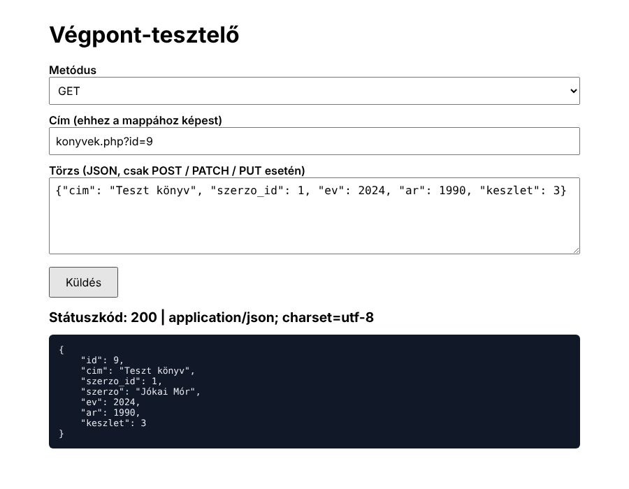

# 0_GYORSINDITO (PHP)

Egy **működő mini-backend** (könyvtár: szerzők és könyvek), amiben minden gyakori PHP-feladat benne van, jelölt blokkokban.

```
konyvtar/
├─ adatbazis.sql   ← phpMyAdminban importálod (létrehozza a "konyvtar" adatbázist)
├─ config.php      ← [A] kapcsolat: vizsgán csak a $dbname-et írod át
├─ szerzok.php     ← [C] a legegyszerűbb végpont: lista, csak GET, más metódusra 405
├─ konyvek.php     ← minden metódus, blokkonként: [A]–[H]
└─ teszt.html      ← böngészős tesztelő GET / POST / PATCH / PUT / DELETE kérésekhez
```

| Blokk | Mi ez | Tipikus feladatszöveg |
|---|---|---|
| **[A]** | `require_once`, fejléc, `valasz()`, `keresTorzse()` | „minden válasz JSON… Content-Type” |
| **[B]** | metódus + `?id=` kiolvasása | – |
| **[C]** | lista szűrőkkel (`?szerzo_id=`, `?kereses=`), JOIN, rendezés | „az összes … név szerint”, „elhagyható paraméter” |
| **[D]** | egy elem `?id=` alapján, 404 | „?id=N: egyetlen …, ha nincs: 404” |
| **[E]** | POST: törzs, ellenőrzések (400), INSERT, 201 | „új … felvétele … ellenőrzések” |
| **[F]** | PATCH: hiányzó id (400), ellenőrzés, 404, UPDATE | „… módosítása” |
| **[G]** | DELETE: 404, törlés, 200 | „… törlése” |
| **[H]** | minden más: 405 | „egyéb metódusra 405” |

## Kipróbálás otthon

1. XAMPP: Apache + MySQL **Start**.
2. phpMyAdmin → **Importálás** → `adatbazis.sql`.
3. Másold a `konyvtar` mappát ide: `C:\xampp\htdocs\konyvtar`
4. Böngésző: **http://localhost/konyvtar/konyvek.php** és **http://localhost/konyvtar/teszt.html**



## Ellenőrizve (PHP 8.3 + MariaDB)

| Kérés | Válasz |
|---|---|
| GET `szerzok.php` | 200, 4 szerző név szerint |
| DELETE `szerzok.php` | 405 |
| GET `konyvek.php?szerzo_id=4` | 200, 2 könyv |
| GET `konyvek.php?kereses=EMBER` | 200, a címben „ember” (kis/nagybetű nem számít) |
| GET `konyvek.php?id=3` / `?id=99` | 200 objektum / 404 |
| POST új könyv / üres cím / nem létező szerző | 201 + id / 400 / 400 |
| PATCH `?id=8` / `?id=99` / id nélkül / negatív készlet | 200 / 404 / 400 / 400 |
| DELETE `?id=8` kétszer | 200, majd 404 |
| PUT | 405 |

## Használat a vizsgán

1. `config.php` → átmásolod, `$dbname` = a feladat adatbázisa.
2. A kért fájlnévvel (pl. `termekek.php`) új fájl → a `konyvek.php`-ból a kellő blokkok.
3. Átírod: **táblanevek**, **oszlopnevek**, a JSON **kulcsai** (a feladat mintaválasza szerint!), az **üzenetek** szövege.
4. Böngészőben / `teszt.html`-lel kipróbálod.
