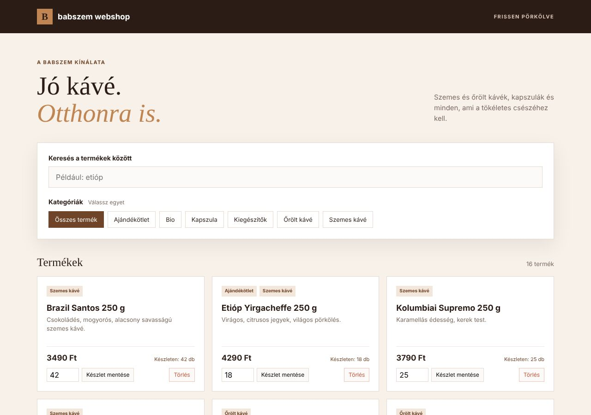

# 01 – Babszem webshop: PHP backend (15 pont)

> A tanárotok gyakorló feladatsorának III. része. Az eredeti feladatlap: [Feladatleiras_Babszem.pdf](Feladatleiras_Babszem.pdf) (9–12. oldal).
> A frontend **kész**, csak a `backend` mappába kell megírni 3 PHP fájlt.

## Előkészítés (a feladat szerint)

1. XAMPP: **Apache** és **MySQL** indítása.
2. phpMyAdmin → Importálás → [Megoldas/babszem_webshop.sql](Megoldas/babszem_webshop.sql) (6 kategória, 16 termék).
3. A `babszem_webshop` mappa a `xampp/htdocs`-ba. A PHP fájlok a `backend` almappába.
4. Frontend: **http://localhost/babszem_webshop/frontend/index.html**. Ez a `../backend/termekek.php` és a `../backend/kategoriak.php` fájlt hívja, ezért a fájlneveknek pontosan ilyennek kell lenniük.

## Az adatbázis

| Tábla | Mezők |
|---|---|
| `categories` | id (PK, AUTO_INCREMENT), name |
| `products` | id (PK), name, description (lehet NULL), price (egész, Ft), stock (egész, db) |
| `product_categories` | product_id → products.id, category_id → categories.id (**kapcsolótábla**: egy termék több kategóriába is tartozhat) |

## A feladatok, és hol vannak megoldva

| # | Pont | Feladat | Megoldás |
|---|---|---|---|
| 1 | 1 | `config.php`: PDO, utf8mb4, ERRMODE_EXCEPTION; a többi fájl `require_once`-szal tölti be | [config.php](Megoldas/babszem_webshop/backend/config.php) |
| 2 | 1 | `kategoriak.php`: GET → minden kategória (id, name) **név szerint**; más metódusra 405 + `{"error": "Method not allowed"}` | [kategoriak.php](Megoldas/babszem_webshop/backend/kategoriak.php) |
| 3 | 4 | `termekek.php` GET: minden termék **id szerint**, mindegyikben `categories` tömb (id, name), **LEFT JOIN** + csoportosítás; kategória nélküli → `[]`; id, price, stock **számként** | [termekek.php](Megoldas/babszem_webshop/backend/termekek.php) → `termekekLekerdezese()` |
| 4 | 2 | `termekek.php?id=N` GET: egy termék **objektumként**; ha nincs: 404 + `{"error": "A termék nem található."}`; **prepared statement** | GET ág |
| 5 | 3 | POST: új termék JSON-ból (name, description, price, stock, categories); ellenőrzések (400); **tranzakció**; 201 + `{"message": "Termék sikeresen hozzáadva.", "id": 17}` | POST ág |
| 6 | 2 | `?id=N` PATCH: készlet (`{"stock": 15}`); negatív/hiányzó: 400; nincs ilyen: 404; siker: 200 | PATCH ág |
| 7 | 1 | `?id=N` DELETE: **előbb a kapcsolótábla**; nincs ilyen: 404; siker: 200 + `{"message": "Termék törölve."}` | DELETE ág |
| 8 | 1 | minden válasz `Content-Type: application/json; charset=utf-8`; PATCH/DELETE id nélkül: 400 „Hiányzó azonosító.”; egyéb metódus: 405 | a fájl eleje és vége |

## Ellenőrzés: minden végpontot lefuttattam (PHP 8.3 + MariaDB)

| Kérés | Kapott válasz | Egyezik a mintával? |
|---|---|---|
| GET `kategoriak.php` | 200, 6 kategória: Ajándékötlet (6), Bio (5), Kapszula (3), Kiegészítők (4), Őrölt kávé (2), Szemes kávé (1) | ✅ |
| POST `kategoriak.php` | 405 `{"error":"Method not allowed"}` | ✅ |
| GET `termekek.php` | 200, 16 termék id szerint, az id/price/stock szám | ✅ |
| GET `termekek.php?id=2` | 200, Etióp Yirgacheffe, categories: Ajándékötlet + Szemes kávé | ✅ |
| GET `termekek.php?id=99` | 404 `{"error": "A termék nem található."}` | ✅ |
| POST Kenyai AA (a minta) | 201 `{"message": "Termék sikeresen hozzáadva.", "id": 17}` | ✅ |
| POST üres név / ár -5 / ár "abc" / készlet -1 / kategória 99 | 400, a megfelelő üzenettel | ✅ |
| POST kategóriák nélkül, majd GET | 201, utána `"categories": []` | ✅ |
| PATCH `?id=6` `{"stock":15}` | 200 `{"message": "Készlet frissítve.", "id": 6, "stock": 15}` | ✅ |
| PATCH negatív / üres törzs / `?id=99` / id nélkül | 400 / 400 / 404 / 400 „Hiányzó azonosító.” | ✅ |
| DELETE `?id=1`, majd GET, majd újra DELETE | 200 „Termék törölve.” → 404 → 404 | ✅ |
| DELETE id nélkül | 400 „Hiányzó azonosító.” | ✅ |
| PUT | 405 `{"error": "Method not allowed"}` | ✅ |
| minden válasz fejléce | `application/json; charset=utf-8` | ✅ |

A kész frontend a backenddel (16 termék, 7 szűrőgomb, hiba nélkül):

**Lépésről lépésre:** [LEPESROL_LEPESRE.md](LEPESROL_LEPESRE.md) · **Megoldás:** [Megoldas/babszem_webshop/backend/](Megoldas/babszem_webshop/backend/)
