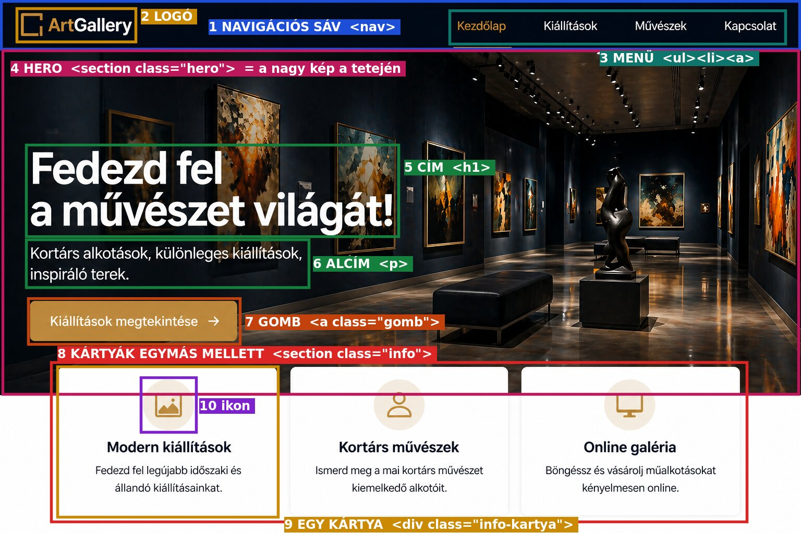
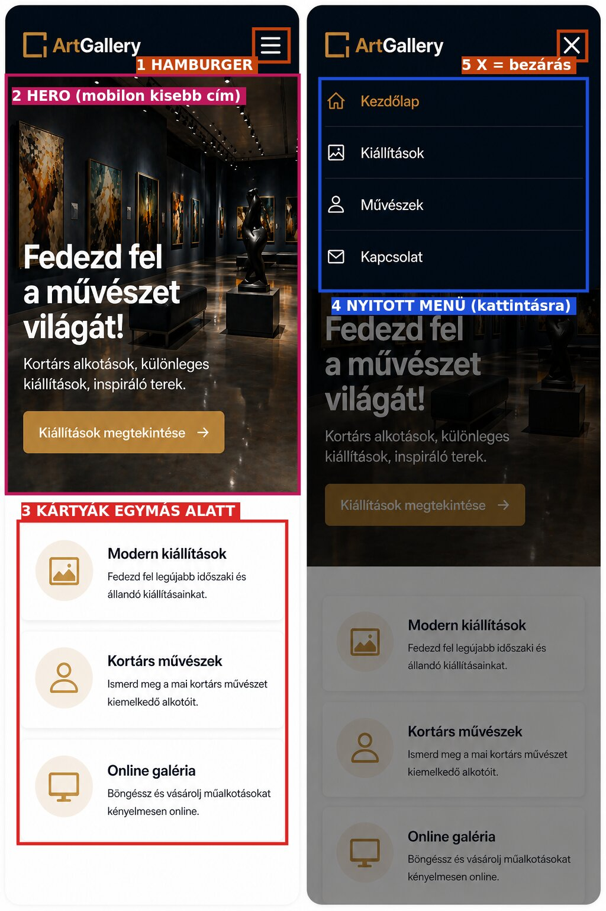
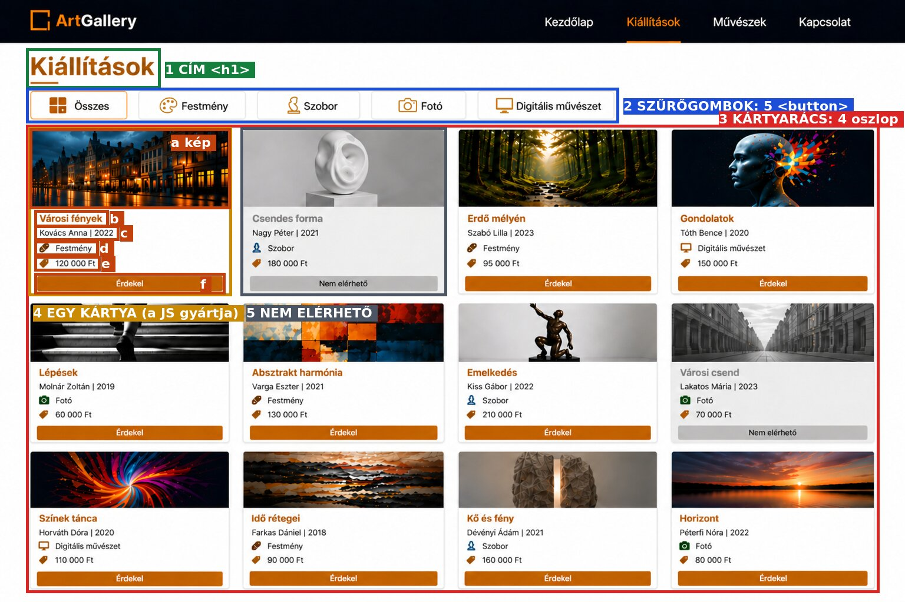

# WEB a nulláról – KEZDD ITT

Ha a webről semmit nem tudsz, ezt olvasd végig **sorban** (kb. 25 perc). Utána tudni fogod:
- hogyan nézd meg a mintaképet, és **honnan tudod, melyik rész a hero, melyik a navigáció, melyik a kártya**,
- melyik részből milyen HTML lesz,
- hogyan csinálsz egy működő oldalt, ami mobilon is jól néz ki.

---

## 1. Mit kapsz a vizsgán?

1. **Feladatlap**: felsorolja a részeket („navigációs sáv…”, „hero szekció…”, „3 információs kártya…”).
2. **Mintaképek**: hogyan néz ki az oldal **asztali gépen** és **mobilon**.
3. **images** mappa a képekkel (logó, háttérkép, ikonok), néha egy **szöveg.txt** a szövegekkel.
4. Frontend-feladatnál egy **.json** fájl az adatokkal (pl. `artworks.json`).

> A weboldal 3 fájl: **index.html** (mi van az oldalon), **style.css** (hogyan néz ki), **script.js** (mi történik kattintásra).

---

## 2. A mintakép szétszedése: melyik rész micsoda?

### A kezdőlap (asztali)



| # | Amit látsz | A neve | HTML | Honnan ismered fel? |
|---|---|---|---|---|
| 1 | a legfelső sötét **csík** | **navigációs sáv** (navbar, menüsor) | `<header><nav>` | mindig a legtetején, végig az oldal szélességében |
| 2 | kép + név balra | **logó** | `<a class="logo"></a>` | a navigáció bal szélén |
| 3 | szavak egymás mellett jobbra | **menü** | `<ul><li><a>...</a></li></ul>` | kattintható szavak a navigációban |
| 4 | a navigáció **alatti** nagy kép, rajta nagy szöveg és gomb | **HERO** | `<section class="hero">` | ⬇ lásd lent |
| 5 | a legnagyobb szöveg | **cím** | `<h1>` | az oldal legnagyobb betűje |
| 6 | kisebb szöveg a cím alatt | **alcím** | `<p>` | rövid mondat |
| 7 | színes, lekerekített doboz felirattal | **gomb** | `<a class="gomb">` | kattintható, kiemelt szín |
| 8 | egymás melletti dobozok sora | **kártyák (rács)** | `<section class="info">` | több **egyforma szerkezetű** doboz |
| 9 | egy doboz | **kártya** | `<div class="info-kartya">` | fehér, árnyékos, lekerekített |
| 10 | kis kép a kártyában | **ikon** | `` | |

### ⭐ Honnan tudod, hogy valami HERO?

A **hero** = az oldal **első, nagy, figyelemfelkeltő része a navigáció alatt**. Felismered, mert:
- **közvetlenül a navigációs sáv alatt** van,
- **nagy**: a képernyő jó részét kitölti,
- van egy **nagy háttérképe** (vagy erős háttérszíne),
- rajta: **nagy cím**, egy **rövid szöveg**, és általában **egy gomb**.

> Ha a feladat azt írja, hogy „hero szekció” vagy „nagy kiemelt rész a tetején”, akkor **ez az**. Egy oldalon csak egy hero van.

### Ugyanez mobilon



| # | Amit látsz | Mit jelent |
|---|---|---|
| 1 | **három vízszintes vonal** a jobb felső sarokban | **hamburger ikon**: mobilon a menü helyett ez látszik |
| 2 | a hero, de a cím **kisebb** és több sorba tördelve | „a hero szöveg mobilon kisebb betűméretű legyen” |
| 3 | a kártyák **egymás alatt** | „mobilnézetben egymás alatt” (1 oszlop) |
| 4 | a hamburgerre kattintva **lenyíló menü** | a JavaScript kapcsolja ki-be |
| 5 | **X** a hamburger helyén | ezzel zárul be a menü |

### A kiállítások oldal (frontend-feladat)



| # | Amit látsz | HTML / mit csinál a kód |
|---|---|---|
| 1 | oldalcím | `<h1>` |
| 2 | gombsor | **szűrőgombok**: `<button data-kategoria="Festmény">` |
| 3 | sok egyforma doboz, **4 oszlopban** | **kártyarács**: egy üres `<div id="mualkotasok">`, a **JavaScript tölti meg** a JSON-ból |
| 4 | egy kártya: **a** kép, **b** cím, **c** művész \| év, **d** kategória, **e** ár, **f** gomb | a JS gyártja: `<article>` → ``, `<h3>`, `<p>`…, `<button>` |
| 5 | **szürke** kép, szürke „Nem elérhető” gomb | ha a JSON-ban `"available": false` → `filter: grayscale(100%)` + `disabled` gomb |

---

## 3. Web-szótár: a feladatszöveg szavai

| A feladatban… | Jelentése | Hogyan |
|---|---|---|
| **navigációs sáv**, navbar, menüsor | a felső csík a logóval és a menüvel | `<header><nav>` |
| **menüpontok** | a kattintható szavak | `<ul><li><a href="#">Kezdőlap</a></li>…</ul>` |
| **hamburger ikon / menü** | 3 vonal mobilon, kattintásra nyit | `<button>☰</button>` + JS `classList.toggle` |
| **hero** szekció | nagy kép a navigáció alatt, rajta cím + gomb | `<section class="hero">` + `background-image` |
| **háttérkép** | kép a szöveg MÖGÖTT | CSS: `background-image: url("images/hero.png")` |
| **kártya** | keretes/árnyékos doboz, ismétlődik | `<div class="kartya">` |
| **árnyékolt** | árnyék a doboz alatt | `box-shadow: 0 6px 20px rgba(0,0,0,0.12)` |
| **középre igazított** | a szöveg középen | `text-align: center` |
| **egymás mellett / 2 oszlopban / egymás alatt** | hány oszlop | `grid-template-columns: repeat(3, 1fr)` / `repeat(2, 1fr)` / `1fr` |
| **reszponzív** | képernyőmérettől függően máshogy rendeződik | `@media (min-width: ...)` |
| **mobile-first** | először a mobil kinézetet írod meg, aztán a nagyobbat | alap CSS = mobil, `@media (min-width: 768px)` = tablet… |
| **nagy képernyő / közepes / mobil** | asztali / tablet / telefon | ≥ 1024 px / 768–1023 px / < 768 px |
| **lábléc** (footer) | a legalsó sáv | `<footer>` |
| **jelenítsd meg … kártyákon (a JSON-ból)** | a JS gyártja a kártyákat | `forEach` + `innerHTML` |
| **szürkeárnyalatos** | fekete-fehér kép | `filter: grayscale(100%)` |
| **inaktív gomb** | nem lehet rákattintani | `<button disabled>` |
| **szűrő** | gombok, amik csak egy kategóriát mutatnak | gombok + `filter()` |

---

## 4. A képből HTML: a módszer

1. **Húzz képzeletbeli vízszintes vonalakat** a mintaképen a nagy részek közé, fentről lefelé. Minden sáv egy nagy elem:

```
┌───────────────────────────────────────────┐
│ navigáció                                 │  → <header><nav> ... </nav></header>
├───────────────────────────────────────────┤
│                                           │
│ HERO: nagy kép, cím, alcím, gomb          │  → <section class="hero"> ... </section>
│                                           │
├───────────────────────────────────────────┤
│ [kártya]   [kártya]   [kártya]            │  → <section class="info"> 3 × <div class="info-kartya"> </section>
├───────────────────────────────────────────┤
│ lábléc (ha van)                           │  → <footer> ... </footer>
└───────────────────────────────────────────┘
```

2. **Minden sávon belül**: a cím → `<h1>`/`<h2>`, a szöveg → `<p>`, a kép → ``, a gomb → `<a class="gomb">` vagy `<button>`, az ismétlődő doboz → `<div class="kartya">`.

3. **Írd le a vázat** (a számok a fenti képről):

```html
<header class="fejlec">                                    <!-- 1 navigáció -->
    <nav class="navbar">
        <a href="index.html" class="logo"></a>   <!-- 2 -->
        <button class="hamburger" id="hamburger">☰</button>
        <ul class="menu" id="menu">                          <!-- 3 menü -->
            <li><a href="#">Kezdőlap</a></li>
            <li><a href="#">Kiállítások</a></li>
            <li><a href="#">Művészek</a></li>
            <li><a href="#">Kapcsolat</a></li>
        </ul>
    </nav>
</header>

<section class="hero">                                     <!-- 4 HERO -->
    <h1>Fedezd fel a művészet világát!</h1>                <!-- 5 -->
    <p>Kortárs alkotások, különleges kiállítások, inspiráló terek.</p>   <!-- 6 -->
    <a href="#" class="gomb">Kiállítások megtekintése</a>  <!-- 7 -->
</section>

<section class="info">                                     <!-- 8 kártyák -->
    <div class="info-kartya">                              <!-- 9 egy kártya -->
                <!-- 10 ikon -->
        <h2>Modern kiállítások</h2>
        <p>Fedezd fel legújabb időszaki és állandó kiállításainkat.</p>
    </div>
    <!-- + még 2 ugyanilyen kártya -->
</section>
```

> ⚠️ **A logóra figyelj:** a Galéria `logo.png`-jén nagy üres (átlátszó) szél van, ezért sima ``-ként óriási lenne. Vagy vágd ki Paintben (Kijelölés → Kivágás → Mentés másként), vagy adj neki méretet a CSS-ben, vagy lásd a [02 technikát](1_TECHNIKAK/02_Navigacio_hamburger.md). Vizsgán mindig nézd meg, mekkora a kapott kép!

4. **Utána a CSS**: először mobilra (minden egymás alatt), a végén `@media`-val a nagyobb képernyőkre. Kész kód: [0_GYORSINDITO/style.css](0_GYORSINDITO/style.css).

---

## 5. Az első weboldalad 10 perc alatt (gyakorold ezt egyszer!)

1. Hozz létre egy mappát (pl. `proba`), és nyisd meg **VS Code**-ban: **File → Open Folder**.
2. Új fájl: `index.html`. Írd be: **`!`** és nyomj **Enter**-t. A VS Code megírja a vázat. A `lang="en"`-t írd át `lang="hu"`-ra.
3. A `<body>` és a `</body>` közé írd be:

```html
<section class="hero">
    <h1>Szia, ez az első oldalam!</h1>
    <p>Ez egy rövid alcím.</p>
    <a href="#" class="gomb">Gomb</a>
</section>

<section class="info">
    <div class="kartya">Első kártya</div>
    <div class="kartya">Második kártya</div>
    <div class="kartya">Harmadik kártya</div>
</section>
```

4. A `<head>`-be, a `</head>` elé: `<link rel="stylesheet" href="style.css">`
5. Új fájl: `style.css`:

```css
body { font-family: Arial, sans-serif; margin: 0; }

.hero {
    background: #1e293b;          /* háttér (képpel: background-image: url("kep.jpg")) */
    color: white;
    padding: 60px 20px;
}
.hero h1 { font-size: 2rem; }    /* MOBIL: kisebb cím */

.gomb { background: orange; color: white; padding: 10px 20px; text-decoration: none; border-radius: 6px; }

.info {
    display: grid;
    grid-template-columns: 1fr;   /* MOBIL: 1 oszlop = egymás alatt */
    gap: 20px;
    padding: 20px;
}
.kartya {
    padding: 30px;
    text-align: center;                            /* középre igazítva */
    border-radius: 10px;
    box-shadow: 0 6px 20px rgba(0, 0, 0, 0.15);    /* árnyék */
}

@media (min-width: 768px) {                        /* TABLETTŐL */
    .info { grid-template-columns: repeat(2, 1fr); }
    .hero h1 { font-size: 3rem; }
}
@media (min-width: 1024px) {                       /* ASZTALITÓL */
    .info { grid-template-columns: repeat(3, 1fr); }
}
```

6. Nyisd meg az `index.html`-t dupla kattintással. Utána a böngészőben **F12 → Ctrl+Shift+M**, és állítsd a szélességet: 390 → egymás alatt; 800 → 2 oszlop; 1280 → 3 egymás mellett.

**Ami most történt, az a vizsga weboldal-részének lényege:**

```
 mintakép → sávokra bontás → HTML váz → CSS mobilra → @media nagyobbra → kipróbálás (F12)
```

---

## 6. Hogyan tovább?

1. [0_ALAPOK_KEZDOKNEK.md](0_ALAPOK_KEZDOKNEK.md): HTML / CSS / JS szerepe (5 perc)
2. [Galéria lépésről lépésre](2_GYAKORLO_FELADATOK/01_Galeria/LEPESROL_LEPESRE.md): a mintafeladat végig
3. [README.md](README.md): a lépések és a keresőtábla, ezt használd a vizsgán
