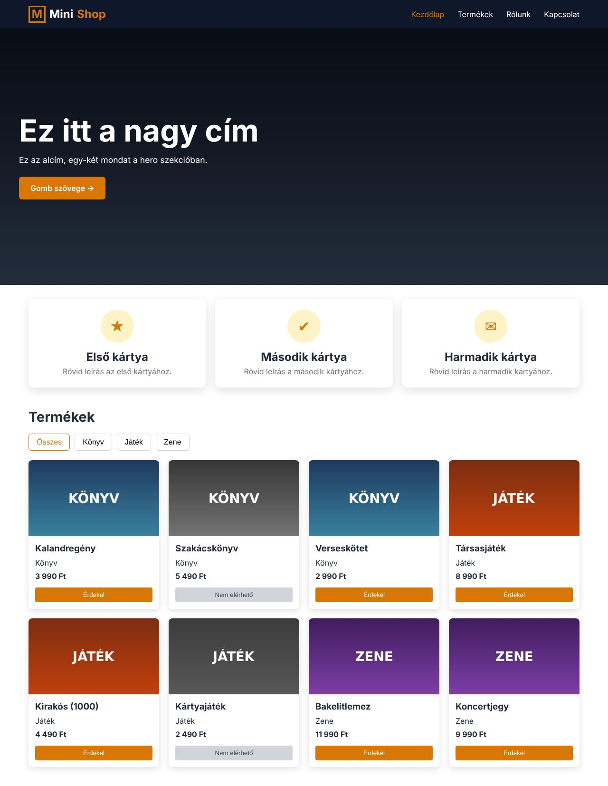

# 0_GYORSINDITO (WEB)

Egy kész oldal, amiben a vizsga web-részének **minden gyakori eleme** benne van. Dupla kattintással megnyílik az `index.html`, szerver nem kell.
Minden fájlban ugyanazok a jelek: **[A]–[H]**, így a HTML-, a CSS- és a JS-részt is könnyen összepárosítod.

| Blokk | Mi ez | HTML | CSS | JS | Technika |
|---|---|---|---|---|---|
| **[A]** | HTML váz, két kötelező `meta` | ✔ | ✔ alapok | | [01](../1_TECHNIKAK/01_HTML_szerkezet.md) |
| **[B]** | navigáció + hamburger | ✔ | ✔ | ✔ | [02](../1_TECHNIKAK/02_Navigacio_hamburger.md) |
| **[C]** | hero: háttérkép, cím, alcím, gomb | ✔ | ✔ | | [03](../1_TECHNIKAK/03_Hero_szekcio.md) |
| **[D]** | 3 árnyékolt kártya | ✔ | ✔ | | [04](../1_TECHNIKAK/04_Kartyak_arnyekkal.md) |
| **[E]** | reszponzív: 1 → 2 → 3/4 oszlop | | ✔ `@media` | | [05](../1_TECHNIKAK/05_Reszponziv_mobile_first.md) |
| **[F]** | adatok: `adatok.js` (`const termekek = [...]`) | ✔ script sorrend | | ✔ (fetch kommentben) | [06](../1_TECHNIKAK/06_JSON_betoltes.md) |
| **[G]** | kártyák az adatokból + „nem elérhető” | ✔ üres tároló | ✔ | ✔ | [07](../1_TECHNIKAK/07_Kartyak_JS_bol.md), [08](../1_TECHNIKAK/08_Nem_elerheto.md) |
| **[H]** | kategóriaszűrő gombok | ✔ | ✔ | ✔ | [09](../1_TECHNIKAK/09_Kategoria_szuro.md) |

## Ellenőrizve (fej nélküli Chrome)

| | mobil 390 px | tablet 800 px | asztali 1280 px |
|---|---|---|---|
| hamburger | látszik, nyílik | nincs | nincs |
| hero cím | 35 px | 51 px | 64 px |
| info kártyák | 1 oszlop | 2 oszlop | 3 oszlop |
| termékkártyák | 1 oszlop | 2 oszlop | 4 oszlop |
| szűrő | Könyv 3, Játék 3, Zene 2, Összes 8 | | |

## Használat a vizsgán

1. Másold a három fájlt (`index.html`, `style.css`, `script.js`) a feladat mappájába.
2. A kapott JSON-ból csinálj `.js`-t (elé `const adatnev = `, végére `;`), és javítsd a képútvonalakat.
3. Írd át: szövegek, mezőnevek (`t.nev` → `mu.title` …), a szűrőgombok `data-kategoria` értékei, a képek útvonala.
