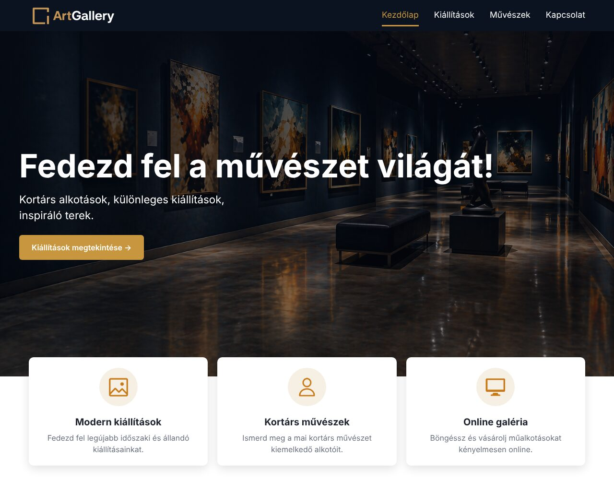
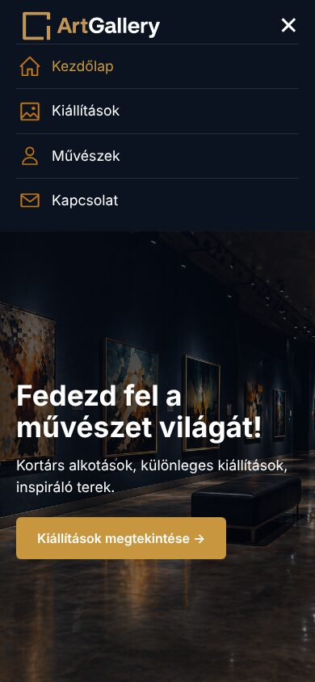
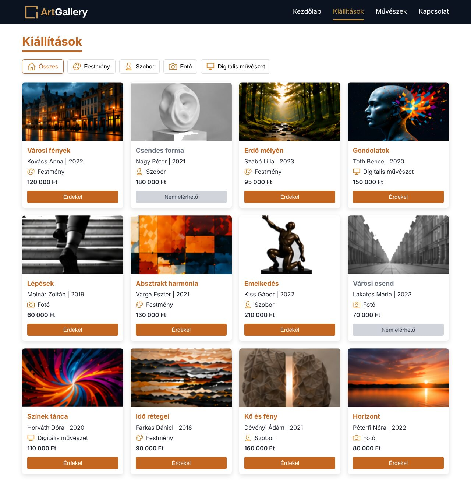
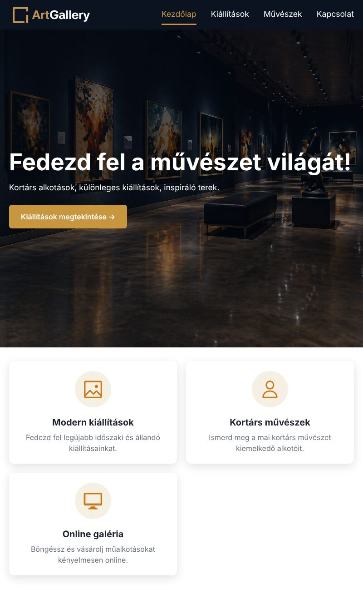
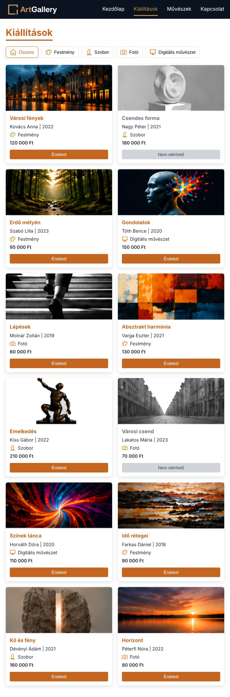
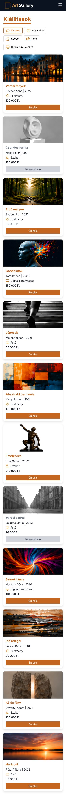
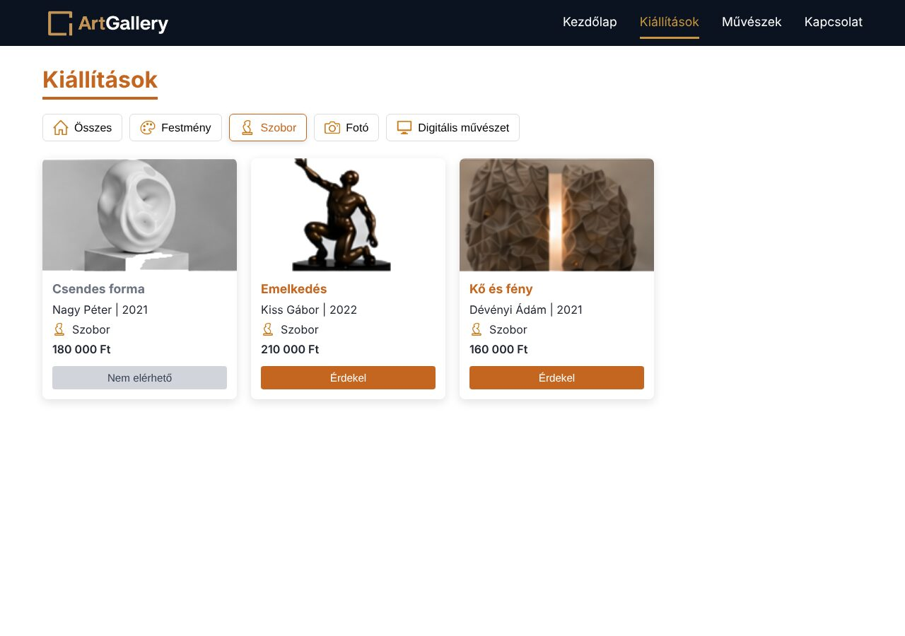

# 01 – Galéria weboldal (a kapott mintafeladat)

> Az eredeti feladatlap szövege, és mellette, hogy **melyik pontot hol oldja meg** a megoldás.
> A mintaképek a [minta/](minta/) mappában vannak, az eredeti JSON: [minta/artworks_EREDETI.json](minta/artworks_EREDETI.json).

## A) Reszponzív weboldal készítése és formázása – 10 pont

Készítsd el egy művészeti galéria kezdőoldalát a leírás és a mellékelt fájlok alapján!

| # | Követelmény | Hol van a megoldásban |
|---|---|---|
| 1 | Navigációs sáv: bal oldalon a logó és a név (**ArtGallery**); menüpontok: Kezdőlap, Kiállítások, Művészek, Kapcsolat; **mobilon hamburger ikon** | `index.html` → `<header>`; `style.css` 1. rész; `script.js` |
| 2 | **Hero szekció**: háttérkép, cím: „Fedezd fel a művészet világát!”, alcím: „Kortárs alkotások, különleges kiállítások, inspiráló terek.”, gomb: „Kiállítások megtekintése” | `index.html` → `.hero`; `style.css` 2. rész |
| 3 | **3 információs kártya** (Modern kiállítások, Kortárs művészek, Online galéria), árnyékoltak, középre igazítottak | `index.html` → `.info`; `style.css` 3. rész |
| 4 | **Reszponzív:** mobile-first; nagy képernyőn a kártyák egymás mellett, közepesen 2 oszlopban, mobilon egymás alatt; a hero szöveg mobilon kisebb | `style.css`: alap = mobil, `@media (min-width: 768px)` = tablet, `@media (min-width: 1024px)` = asztali |

## B) Frontend programozás – 15 pont

A galéria kiállított műalkotásait kell megjeleníteni adatforrásból.

| # | Követelmény | Hol van a megoldásban |
|---|---|---|
| 1 | Készítsd elő feldolgozásra az `artworks.json` fájlt | `artworks.js`: a képútvonalak **javítva** (a JSON-ban rosszak voltak!), és JS-változóba téve |
| 2 | Kártyák: kép, cím, művész, évszám, kategória, ár, „Érdekel” gomb | `galeria.js` → `kartyakMegjelenitese()` |
| 3 | Ha nem elérhető: **szürkeárnyalatos** kép, **inaktív** gomb, „**Nem elérhető**” felirat | `galeria.js` (`nem-elerheto` osztály, `disabled`); `style.css` 4. rész vége |
| 4 | Kategóriaszűrő: Összes, Festmény, Szobor, Fotó, Digitális művészet | `kiallitasok.html` → `.szuro`; `galeria.js` 4. rész |
| 5 | Elrendezés: nagy képernyőn **4**, tableten **2**, mobilon **1** oszlop | `style.css` → `.mualkotasok` + a két `@media` |
| 6 | Egységes méretű, esztétikus, reszponzív kártyák | `style.css`: fix képmagasság + `object-fit: cover`, a gomb mindig alul (`margin-top: auto`) |

## ⚠️ A csapda: rossz képútvonalak a JSON-ban

Az eredeti `artworks.json`-ban ilyen útvonalak vannak: `images/varosi-fenyek.jpg`. **Ilyen fájl nincs!** A képek valójában itt vannak: `images/card_images/city_lights.png` (angol névvel, `.png`). Ezt kell javítani („előkészíteni”):

| Alkotás | Eredeti (rossz) | Javított |
|---|---|---|
| Városi fények | images/varosi-fenyek.jpg | images/card_images/city_lights.png |
| Csendes forma | images/csendes-forma.jpg | images/card_images/csendes_forma.png |
| Erdő mélyén | images/erdo-melyen.jpg | images/card_images/forest.png |
| Gondolatok | images/gondolatok.jpg | images/card_images/thoughts.png |
| Lépések | images/lepesek.jpg | images/card_images/steps.png |
| Absztrakt harmónia | images/absztrakt-harmonia.jpg | images/card_images/abstract_harmony.png |
| Emelkedés | images/emelkedes.jpg | images/card_images/thinking.png |
| Városi csend | images/varosi-csend.jpg | images/card_images/silent_city.png |
| Színek tánca | images/szinek-tanca.jpg | images/card_images/dance_of_colors.png |
| Idő rétegei | images/ido-retegei.jpg | images/card_images/layers_of_time.png |
| Kő és fény | images/ko-es-feny.jpg | images/card_images/stone_and_light.png |
| Horizont | images/horizont.jpg | images/card_images/horizon.png |

> A párosítást a mintakép ([minta/collections.jpg](minta/collections.jpg)) alapján lehet eldönteni. A két kétes: a **thoughts.png** a fej (Gondolatok), a **thinking.png** a szobor (Emelkedés).

## Ellenőrzés (fej nélküli Chrome-ban, 390 / 800 / 1280 px szélességben)

| Mit | Mobil 390 px | Tablet 800 px | Asztali 1280 px |
|---|---|---|---|
| hamburger | látszik, kattintásra nyit/zár | nincs | nincs |
| hero cím betűmérete | 35 px | 51 px | 67 px |
| info kártyák oszlopai | 1 | 2 | 3 |
| műalkotás oszlopok | 1 | 2 | 4 |
| kártyák | 12 db, egyforma magasak | | |
| nem elérhető | 2 db: szürke kép, „Nem elérhető”, inaktív | | |
| szűrő | Szobor: 3, Fotó: 3, Összes: 12 | | |
| hibák a konzolban | nincs | | |

| Kezdőlap – asztali | Kezdőlap – mobil, nyitott menü | Kiállítások – asztali |
|---|---|---|
|  |  |  |

| Kezdőlap – tablet | Kiállítások – tablet | Kiállítások – mobil | Szűrő: Szobor |
|---|---|---|---|
|  |  |  |  |

**Lépésről lépésre:** [LEPESROL_LEPESRE.md](LEPESROL_LEPESRE.md) · **Megoldás:** [Megoldas/](Megoldas/)
